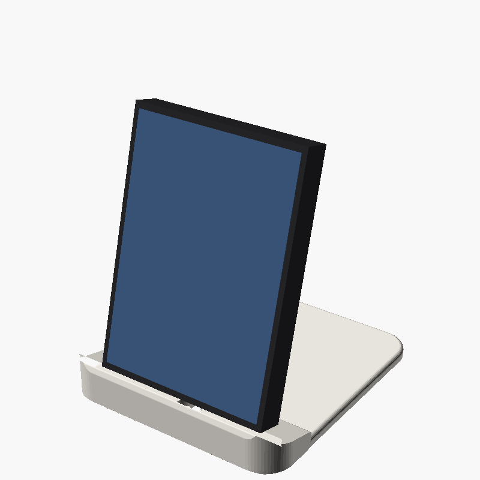
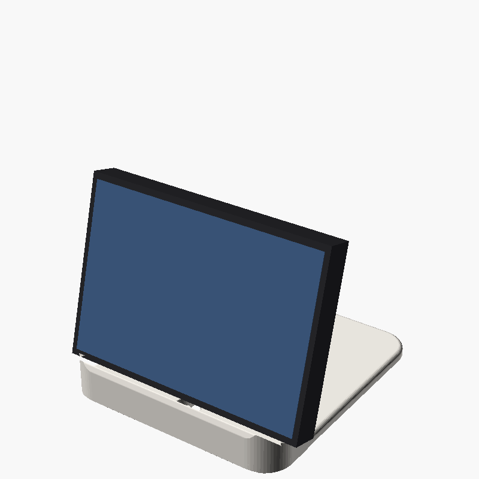
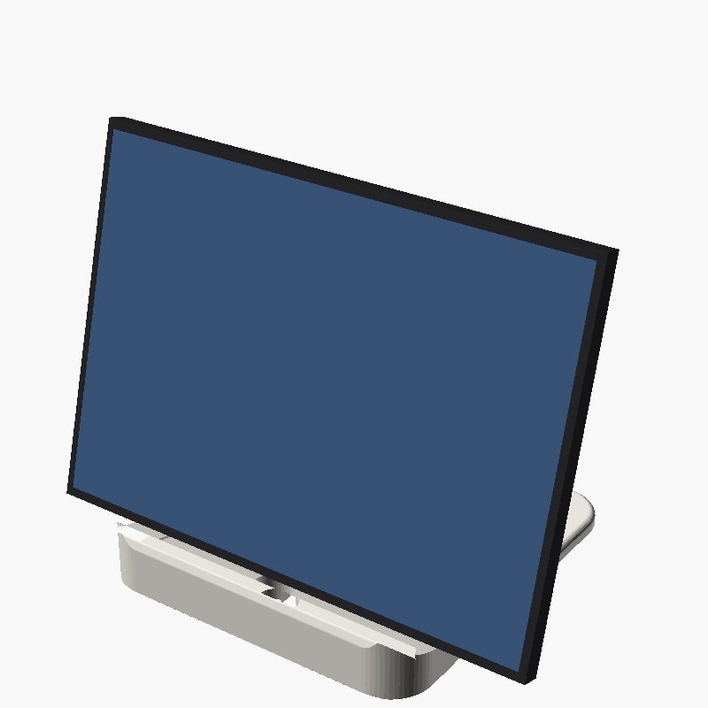
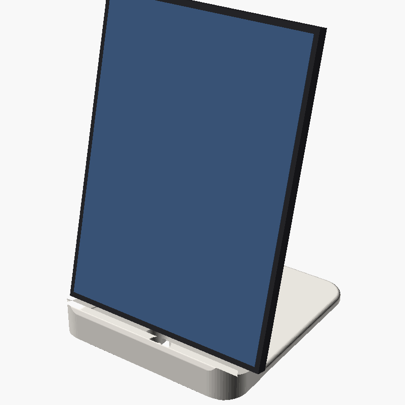
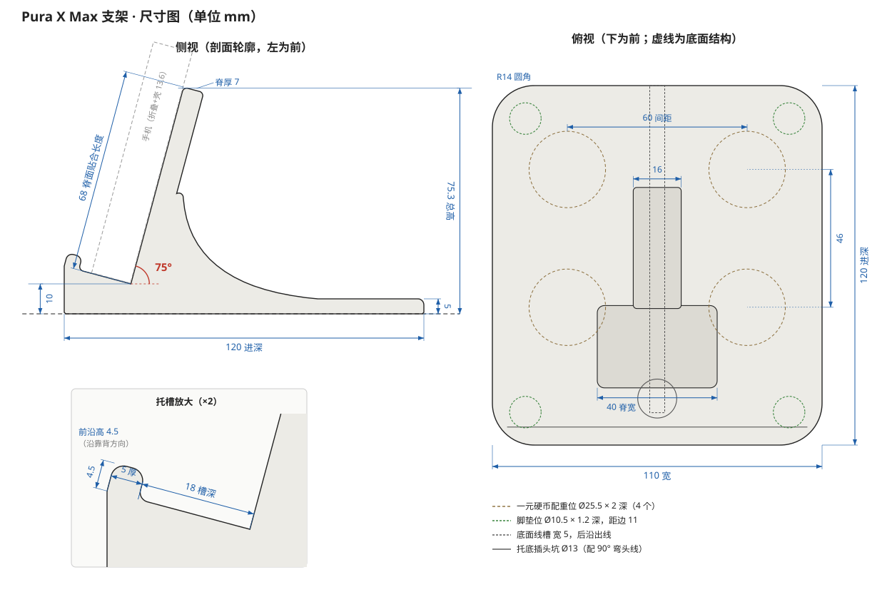
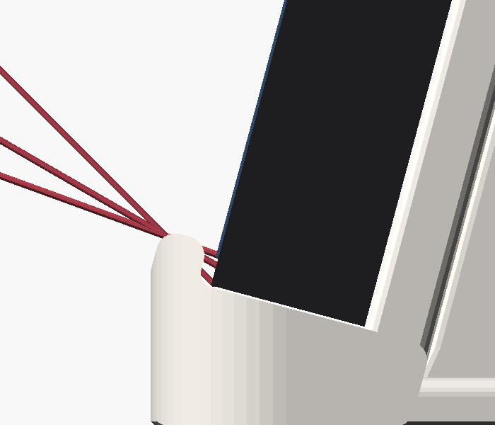

# 华为 Pura X Max 桌面支架

一体式 75° 桌面支架，适配华为 Pura X Max 的四种摆法：折叠竖放、折叠横放、展开横放、展开竖放。带市面上常见的手机壳也能放下。

参数化 OpenSCAD 模型，可以直接打印 `stl/stand.stl`，也可以改参数重新导出。

| 折叠竖放 | 折叠横放 | 展开横放 | 展开竖放 |
|---|---|---|---|
|  |  |  |  |



## 设计要点

- **固定 75°**：托底和靠背成 90°，托底往前是上坡。手机的重量只会把它压向托底和靠背，不需要靠摩擦撑着，也不会往前滑。
- **折叠和展开角度一样**：手机背面总是贴着靠背，厚度变化只会让屏幕前后挪一点，角度不变。
- **避开摄像头**：靠背只有一条居中的窄脊（宽 40）。四种摆法下，后摄模组都落在脊外：要么在脊顶上方，要么在脊的旁边悬空。
- **前挡条不挡屏**：前挡条高 4.5 mm。从前方往下看 20° 以上时不挡屏幕，这是正常坐着看桌上手机的角度。
- **稳**：底座 110 × 120，底面有 4 个一元硬币配重位。把手机推倒向后需要的力见下表。

## 手机壳兼容

托槽深 18 mm（垂直于靠背方向）。

| 折叠后带壳总厚度 | 结果 |
|---|---|
| ≤ 16.5 mm（每面壳约 2.6 mm 以内） | 完全不碰，放进去就是 75° |
| 16.5 – 18 mm | 放得进，手机正面下角会贴到托槽前侧的 R1.5 内圆角 |
| > 18 mm | 放不进，把 `gap` 调大后重新导出 |

- **兼容**：超薄壳、普通 TPU 或 PC 壳、皮革壳、带铰链保护的壳、四角气囊壳。
- **不兼容**：带支架、指环或卡包的加厚壳，重型三防壳。



上图是每面壳 2.6 mm 的折叠竖放。红线是从前方往下 20°、30°、45° 看时擦过前挡条上沿的视线，都落在屏幕下边框上，不挡屏幕。

## 稳定性

按支架用 PLA 打印（约 66 g）、放 4 枚一元硬币、手机 229 g 加壳估算。下表是在屏幕顶边垂直按压时，把整个支架推倒向后所需的力：

| 摆法 | 薄壳 1.2 mm | 厚壳 2.6 mm |
|---|---|---|
| 折叠竖放 | ≈ 258 gf | ≈ 289 gf |
| 折叠横放 | ≈ 402 gf | ≈ 451 gf |
| 展开横放 | ≈ 249 gf | ≈ 278 gf |
| 展开竖放 | ≈ 163 gf | ≈ 181 gf |

日常点按屏幕的力远小于这些值。展开竖放最高，所以裕量最小，可以在这个方向按得轻一点，或者在硬币位里多叠几枚硬币。

## 打印

- **文件**：`stl/stand.stl`，单个实体。
- **摆放**：底面朝下，不需要支撑。
- **材料和参数**：PETG 或 PLA，层高 0.2，4 圈墙，填充 20%。
- **配件（都可选）**：
  - **防滑条**：靠背脊面有两条、托底有一条 0.8 mm 深的浅槽，可以贴硅胶条，或者用 TPU 打印 `stl/pads_tpu.stl`。
  - **配重**：底面有 4 个硬币位，Ø25.5 × 深 2，放一元硬币。
  - **脚垫**：底面有 4 个脚垫位，Ø10.5 × 深 1.2。
  - **充电**：托底中间有插头坑，需要配 90° 弯头 USB-C 线。线从底面线槽里走，从后沿出线。插头坑的位置只对准折叠竖放时的充电口。

## 修改参数

用 OpenSCAD 2021.01 或更新版本打开 `pura_x_max_stand.scad`，在 Customizer 里调整参数：

| 参数 | 默认值 | 作用 |
|---|---|---|
| `angle` | 75 | 靠背与桌面的夹角 |
| `gap` | 18 | 托槽深度。折叠带壳总厚度要不超过 `gap - 1.5` |
| `lip_h` | 4.5 | 前挡条高度 |
| `spine_w` | 40 | 中脊宽度。加宽之前先确认摄像头不会压上去 |
| `cam_*` | 估算值 | 后摄模组的位置和凸起高度，可以按实机量的数据修改 |
| `case_t` | 1.2 | 只影响效果图里的手机，不影响打印出来的支架 |

导出命令：

```bash
openscad -D 'part="stand"' -o stl/stand.stl pura_x_max_stand.scad
```

## 已知限制

- **还没实物打印验证过**。
- **数据来源**：机身尺寸来自[华为官网规格](https://consumer.huawei.com/cn/phones/pura-x-max/specs/)：高 120；展开宽 166.5、厚 5.2；折叠宽 85、厚 11.2。
- **估算的部分**：后摄模组的位置和凸起高度、屏幕下边框宽度都是按公开图片估的。

## 协议

© 2026 Cinnnnnnndy。本项目采用 [CC BY-NC-SA 4.0](https://creativecommons.org/licenses/by-nc-sa/4.0/deed.zh-hans)（署名-非商业性使用-相同方式共享）协议，完整条款见 [LICENSE](LICENSE)。

- **可以**：自己打印、修改、分享。分享时请注明原作者，并附上本仓库链接。
- **不可以**：用于商业用途，比如出售打印件、把模型放进付费合集。
- **改版**：修改后发布的版本也要用同样的协议。

如需商业授权，请开 issue 联系。

## 商标声明

华为、HUAWEI、Pura 是华为技术有限公司的商标。本项目是独立的个人设计，与华为没有任何关联，也没有得到华为的认可或赞助。文中提到这些名称只是为了说明适配的机型。
